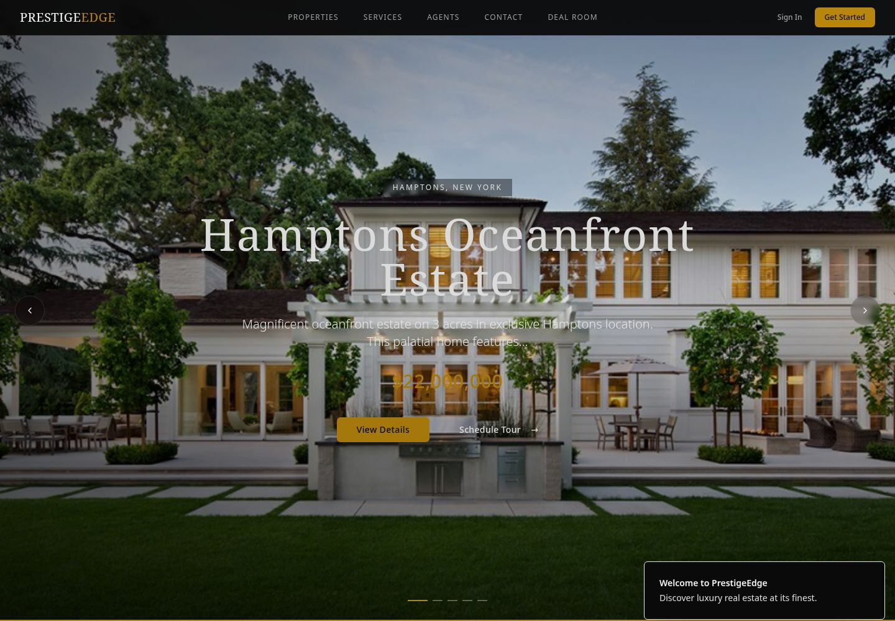
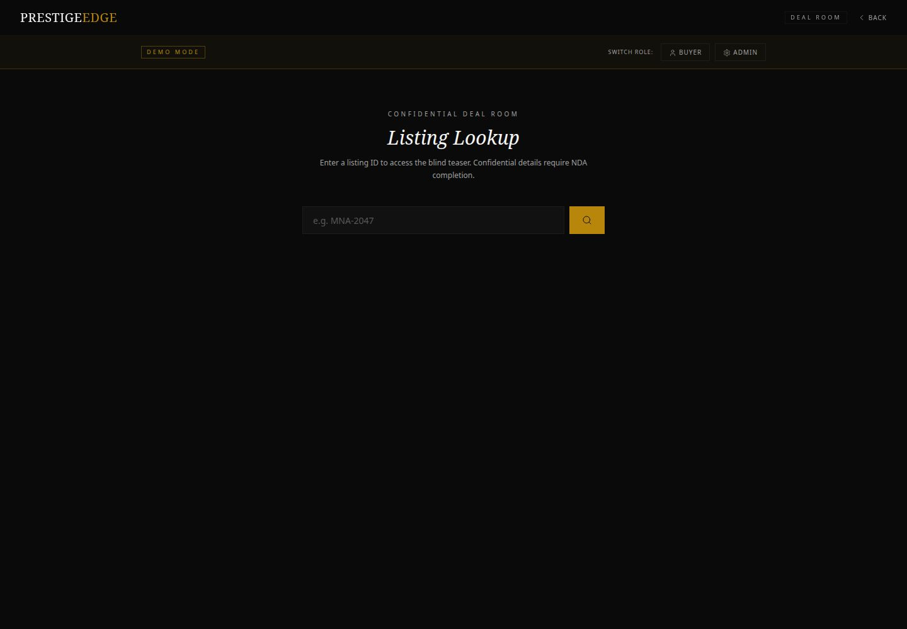
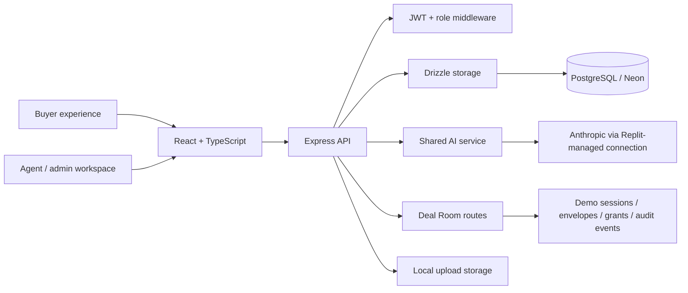

# PrestigeEdge

### Luxury property experiences. AI-assisted agency operations. Confidential transaction workflows.

**A full-stack PropTech platform presented as a client-work engineering case study, combining a premium property experience with buyer intelligence, agent productivity tools, and an emerging confidential Deal Room.**

PrestigeEdge brings the public-facing property journey and the operational tools behind it into one TypeScript application: property discovery, saved collections, inquiries, viewing coordination, messaging, listing administration, and AI-assisted advisory workflows.

The platform is being developed in stages. Its current implementation establishes the product experiences and service boundaries for a broader real-estate intelligence and transaction platform.


*Property-led presentation with a rotating portfolio hero and direct paths to detail and viewing inquiries.*

## Explore the engineering

| Read | What it covers |
| --- | --- |
| [Architecture](docs/architecture.md) | Runtime topology, authentication, data domains, AI flow, and transaction-access sequence |
| [Advanced capabilities](docs/capabilities.md) | Eight AI workflows, dashboard entry points, implementation evidence, and development direction |
| [Deal Room](docs/deal-room.md) | Staged disclosure, envelope ownership, access grants, audit events, and signature-provider interface |
| [API guide](docs/api.md) | Representative endpoints, request shapes, and access boundaries |
| [Local setup](docs/development.md) | Environment configuration, database preparation, and development commands |
| [Verification & publication](docs/publication.md) | Verification evidence, public-release review, and repository packaging |

## The client-work brief

The product addresses two connected needs: an agency's buyers expect an exceptional property experience, while its team needs structured tools for managing listings, relationships, and high-value opportunities.

The engineering objective is to support that journey in one product:

**Discover → shortlist → inquire → coordinate → advise → disclose selectively.**

This case study describes the platform and its implementation. Client identity, commercial terms, private correspondence, and business-performance claims are not included.

## Advanced capabilities

### 01 · Buyer intelligence

- **ARIA concierge:** a server-side language-model integration for short property-service conversations.
- **Preference-led recommendations:** budget, location, bedroom requirements, and candidate listings inform scored property suggestions.
- **Portfolio market intelligence:** supplied inventory provides context for pricing summaries, positioning narratives, and buyer-facing recommendations.

### 02 · Agent productivity and advisory

- **Lead qualification:** structured qualification scores, buyer-profile interpretation, and follow-up prioritisation.
- **Listing narrative generation:** property attributes and selected amenities become draft luxury listing copy.
- **Marketing content:** property-specific drafts for selected content formats.
- **Valuation intelligence:** an initial AI-assisted workflow for indicative value ranges and market-factor narratives.
- **Staging advisory:** room-level concepts, colour schemes, furnishing direction, budget estimates, and implementation timelines establish the planning layer for future visual staging.

The eight workflows share the [AI service](server/services/ai.ts), with dedicated client and agent interfaces. [See the capability matrix and development stages →](docs/capabilities.md)

### 03 · Confidential transaction infrastructure

The Deal Room demonstrates a separate disclosure lifecycle:

**Blind teaser → NDA request → signature-envelope state → buyer-specific grant → confidential record and document.**

Confidential Deal Room reads are checked on the server, rather than merely hidden in the browser. Envelope ownership, per-listing access grants, and event records make the workflow inspectable.

The current phase uses demonstration signing and process-local state to exercise the access lifecycle. Durable transaction storage, verified signature-provider callbacks, and production identity integration are the next infrastructure stages.


*Buyer and administrator demonstration modes expose the staged-disclosure workflow for review.*

[Inspect the transaction flow and security boundary →](docs/deal-room.md)

### 04 · Agency operations

| Experience | Implementation |
| --- | --- |
| Property discovery | Property catalogue, featured listings, property detail, image galleries, and search suggestions |
| Buyer workspace | Saved properties, inquiries, messages, viewing workflows, recommendations, and market analysis |
| Agent/admin workspace | Listing administration, inquiry management, viewing coordination, consultations, and AI business tools |
| Brand operations | Brand settings and email configuration endpoints |
| Measurement | Dashboard statistics and analytics endpoints; selected marketing metrics are illustrative |

## Architecture at a glance



### Engineering highlights

- **Shared TypeScript domain model:** Drizzle table definitions and insert schemas connect the API and client data types.
- **Role-aware API:** bearer JWT verification resolves the active user; route middleware distinguishes agent/admin tools from general authenticated workflows.
- **Server-controlled disclosure:** Deal Room routes check session, role, envelope ownership, and per-listing grants at the relevant boundary.
- **Inspectable AI service:** prompts, response parsing, token budgets, selected caching, and continuity responses are visible in one service.
- **Independent transaction module:** Deal Room routes, store, seed listing, and signature-provider contract sit outside the main agency route file.
- **Single-service delivery:** Vite builds the client and esbuild bundles the Express server; one Node process serves the production application.

These are implementation highlights, not a claim that every route or third-party integration has completed production hardening. Architecture and development-stage details are documented alongside the code.

## Technology

| Layer | Stack |
| --- | --- |
| Interface | React 18, TypeScript, Vite 5, Tailwind CSS, Radix UI, Framer Motion |
| Routing & state | Wouter, TanStack Query |
| Forms | React Hook Form, Zod |
| API | Node.js, Express 4, TypeScript |
| Data | PostgreSQL, Neon serverless driver, Drizzle ORM, Drizzle-Zod |
| Authentication | JWT, bcrypt password hashing, server-side role middleware |
| AI | Anthropic SDK with Replit-managed credentials |
| Supporting services | Multer uploads, SMTP email service, Google Maps configuration, subscription service code |

## Run locally

Use Node.js 22+ and a compatible PostgreSQL/Neon database. The runtime requires `DATABASE_URL`; it does not automatically create or seed an empty portfolio.

```bash
npm ci
# Configure the variables documented in .env.example.
# For local .env files, explicitly load them into the process:
set -a
source .env
set +a
npm run dev
```

Prepare the schema separately with `npm run db:push` against a **disposable development database** after reviewing the proposed changes. Do not point that command at a client or production database.

Open port `5000`. Visit `/deal-room` and look up `MNA-2047` to explore the built-in transaction demonstration.

[Full setup, configuration, and reviewer walkthrough →](docs/development.md)

## Project structure

```text
client/src/
  pages/                    Public, buyer, admin, and Deal Room experiences
  components/ai/            Buyer intelligence and description generation
  components/admin/         Agent-facing AI business tools
  components/dashboard/     Listings, inquiries, messages, and viewings
server/
  routes.ts                 Agency API and integration endpoints
  auth.ts                   JWT verification and role checks
  storage.ts                Database-backed domain operations
  services/                 AI, email, and subscription services
  dealroom/                 Disclosure lifecycle and signature-provider contract
shared/schema.ts            Domain tables, insert schemas, and types
docs/                       Architecture, workflows, API, and release evidence
scripts/repository-preflight.mjs
                            Non-destructive publication inventory
```

## Verification

```bash
npm run check
npm run build
node scripts/repository-preflight.mjs
```

Verification outcomes and publication gates are recorded in [docs/publication.md](docs/publication.md). No automated-test coverage, external market-data connection, or production e-signature integration is implied by these commands.

## Attribution and publication

Presented for the **ProdigyProjectStudios** portfolio as client work. The public repository is a curated technical snapshot: local history, chat attachments, account-autofill credentials, and older commercial collateral are excluded.

The existing package metadata declares MIT. This snapshot preserves that metadata and does not assert a different ownership arrangement. Media and third-party dependencies may have separate rights. See the [publication record](docs/publication.md).
