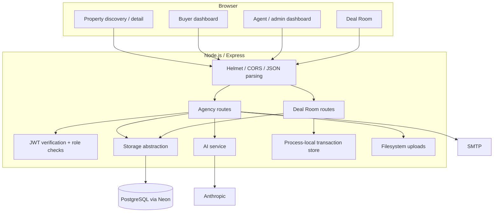
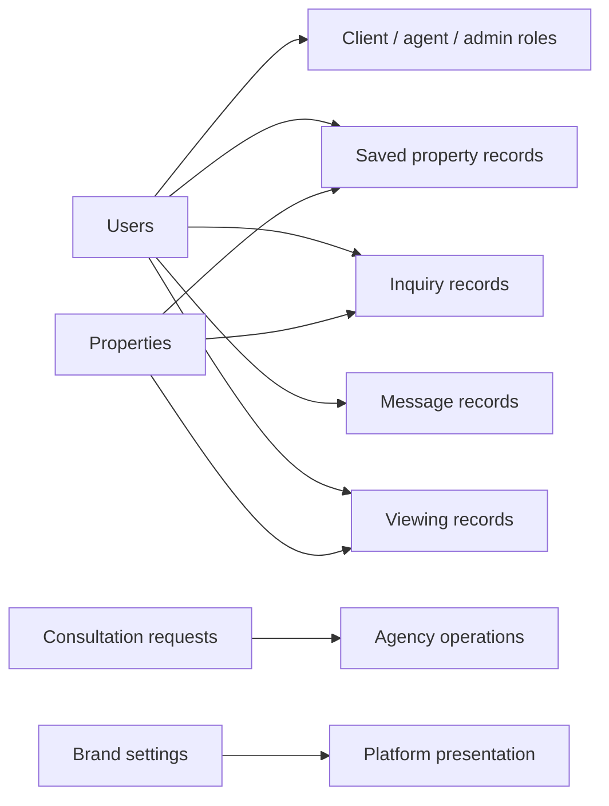
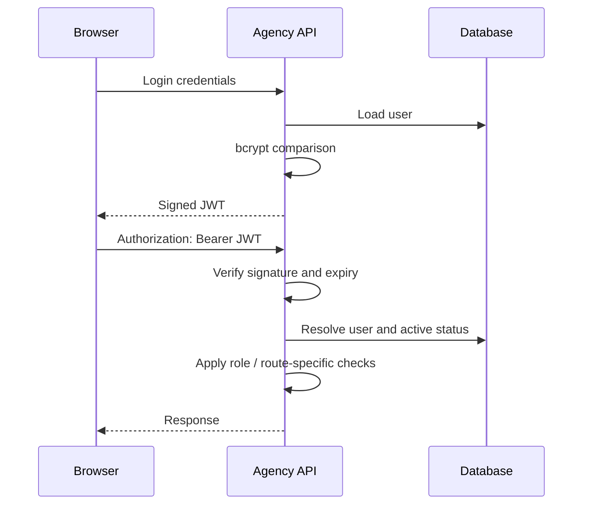
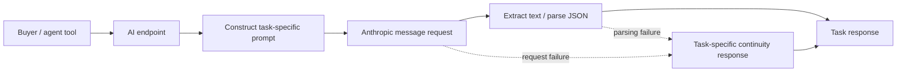
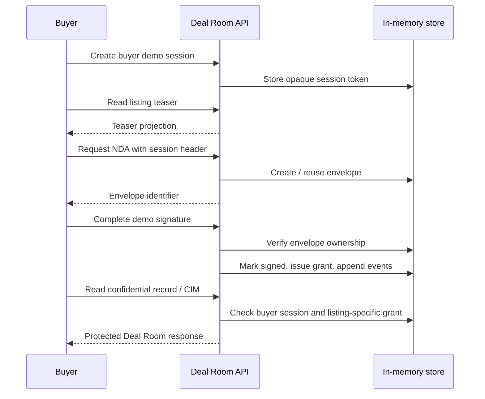

# PrestigeEdge · Architecture

This reference follows the source currently included in the project. The product combines a database-backed agency application with a separately scoped transaction demonstration.

## Runtime topology

In development, Express attaches Vite middleware. In production, it serves the Vite build alongside API routes. Database connectivity is tested before listening; failure prevents startup.

**Source:** [bootstrap](../server/index.ts), [Vite integration](../server/vite.ts), [database](../server/db.ts).

## Domain model

The active schema defines `users`, `properties`, `inquiries`, `saved_properties`, `messages`, `property_viewings`, `consultations`, `brand_settings`, and a `sessions` table. Table presence does not imply that every runtime session uses it: the agency API uses JWTs, while Deal Room sessions use a separate in-memory store.

This diagram describes domain relationships, not a guarantee of database-enforced foreign keys. Inspect [the schema](../shared/schema.ts) for actual constraints and [storage](../server/storage.ts) for queries.

## Authentication and role boundary

`authenticateToken` verifies the token and resolves the active database user. `requireAdmin` and `requireAgentOrAdmin` protect relevant routes. Ownership checks vary by route and must be reviewed individually; this is not a claim of blanket tenant isolation.

Set `JWT_SECRET` explicitly. The current source includes a development fallback secret; production configuration must not depend on it.

**Source:** [authentication](../server/auth.ts), [routes](../server/routes.ts).

## AI request lifecycle

The service uses `claude-sonnet-4-6` and task-specific output budgets. Selected requests pass through an in-process 15-minute cache; other tasks call the provider directly. The current cache key uses a prompt prefix and token budget, so collision resistance is a development priority before describing the cache as an isolation or correctness control.

JSON extraction currently uses text cleanup and `JSON.parse`, rather than output-schema enforcement. Continuity responses maintain UI availability, but responses do not yet expose a uniform live/fallback indicator.

[Capability-level inputs, outputs, and next stages](capabilities.md).

## Transaction-access sequence

The signature-provider interface establishes a future adapter boundary. The current routes create and complete envelopes in the local store; adding a production provider requires wiring its creation and status methods into that lifecycle, not only replacing an exported object.

## Infrastructure development stages

| Established foundation | Next infrastructure stage |
| --- | --- |
| PostgreSQL-backed agency domain | Versioned migrations, reproducible fixtures, operational backup procedures |
| JWT verification and role middleware | Fail-closed configuration, endpoint-by-endpoint authorization review |
| AI request service and continuity paths | Validated output contracts, provenance, bounded usage, full-prompt cache keys |
| Deal Room envelope / grant / event model | Durable transactional storage, identity integration, verified provider callbacks |
| Local media upload flow | Durable object storage and media lifecycle governance |
| Helmet and CORS configuration | Environment-specific policy validation; browser font loading currently needs CSP review |

## Disclosure boundary

Deal Room gating applies to the Deal Room endpoints. Ordinary property endpoints remain a separate public catalogue and may already expose the same property's address, price, or description. Teaser projections may also contain identifying text. A truly confidential inventory requires a cross-platform classification and redaction policy, not just this access flow.
