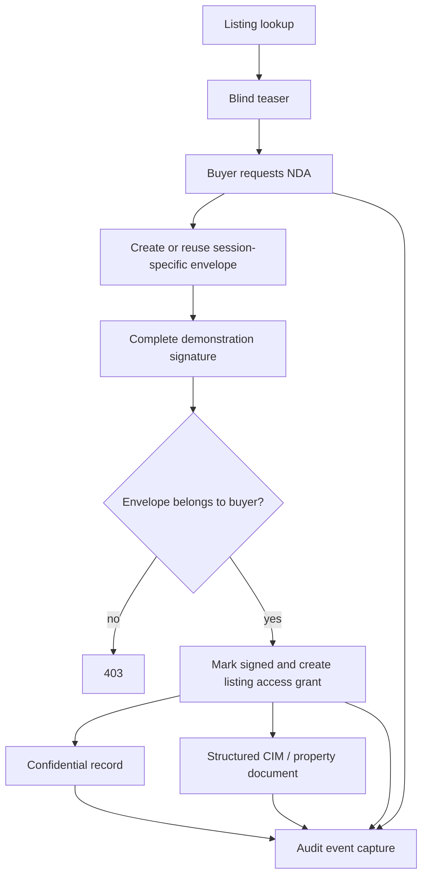

# PrestigeEdge · Confidential transaction infrastructure

The Deal Room is the first implementation of a staged-disclosure workflow for high-value opportunities. It models a transaction lifecycle separately from the public property catalogue and provides buyer and administrator demonstration experiences.

## Lifecycle

## Engineering components

| Component | Responsibility |
| --- | --- |
| [Routes](../server/dealroom/routes.ts) | Session handling, teaser projection, envelope ownership, grant checks, administrator view |
| [Store](../server/dealroom/store.ts) | Session, envelope, grant, and audit-event types and operations |
| [Signature contract](../server/dealroom/signature-provider.ts) | `createEnvelope`, `getEnvelopeStatus`, `verifyWebhook` adapter interface |
| [Demonstration listing](../server/dealroom/seed.ts) | `MNA-2047` opportunity and structured confidential document |
| [Client experience](../client/src/pages/deal-room.tsx) | Buyer/admin role switch, lookup, signing interaction, protected views |

## Identity and grants

The server issues opaque UUID session tokens. Requests send them through `X-DR-Session`. Grants are keyed by session and listing, keeping one listing's grant separate from another.

These sessions are independent of the agency's JWT accounts. The public demo session endpoint lets a reviewer select buyer or administrator mode. That enables review of both journeys; it is not production administrator authentication.

## Envelope semantics

An NDA request reuses an existing envelope for that session/listing. Signing checks envelope ownership. Repeated completion returns the existing grant rather than executing the normal completion path again.

The current store represents envelopes with sent/signed state; the wider type also anticipates created/declined states. Production transition rules, concurrency handling, expiry, and revocation remain next-stage work.

## Audit evidence

Events include:

- Listing viewed, when a recognized session is present.
- NDA requested.
- Envelope created.
- Demonstration signature completed.
- Access grant created.
- Confidential record accessed.
- CIM accessed.

Each record carries an actor, event, listing, detail, and timestamp. Events are append operations in process memory, not an immutable or durable compliance ledger.

## Inventory resolution

`MNA-2047` resolves to the bundled M&A demonstration. Other supported identifiers resolve through the property storage layer. Property documents are assembled as structured JSON sections from available property data; they are not a document-vault or PDF-generation integration.

The teaser projection removes direct confidential fields from its response, but titles, descriptions, and highlights may still identify a property. Public catalogue endpoints are outside the Deal Room boundary. Do not use publicly listed property records as evidence of platform-wide confidentiality.

## Signature-provider integration path

The existing interface defines the intended integration boundary. The current route lifecycle uses the local envelope store and the provider's name; it does not yet invoke all provider methods.

A production integration should:

1. Wire provider envelope creation into the NDA route and retain provider identifiers.
2. Authenticate incoming callbacks and verify their signatures before interpreting status.
3. Resolve provider status server-side; never grant access from an unverified browser completion.
4. Persist envelope, callback, grant, and audit updates transactionally.
5. Add duplicate-event handling, retry policy, expiry, and revocation.
6. Bind grants to verified identities and authorize administrator inspection.

## Infrastructure stages

**Established:** a reviewable staged-disclosure experience with server-side checks, envelope ownership, grant lookup, and audit-event capture.

**Next:** durable storage, verified e-signatures, identity binding, record classification, and operational recovery. Current state resets when the process restarts and is not shared between instances.

## Reviewer walkthrough

1. Open `/deal-room`.
2. Select **Buyer**.
3. Look up `MNA-2047`.
4. Inspect the teaser, request NDA access, and complete the clearly labelled demonstration signature.
5. Inspect the unlocked record and document.
6. Select **Admin**, look up the same listing, and inspect the envelope, grant, and audit views.

Use fictional data only. Demonstration signing is not a legally binding e-signature service.
